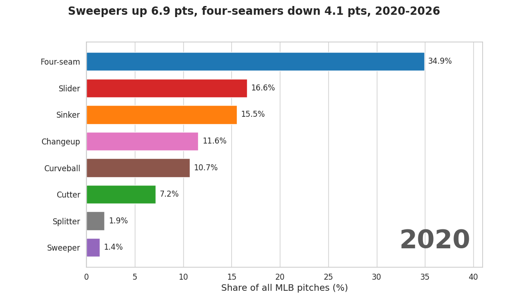

# Kaggle Datasets

Baseball-themed datasets published on Kaggle, generated with [pybaseball](https://github.com/jldbc/pybaseball) and Baseball Savant.

## Published Datasets (7)

### 1. [Japanese MLB Players Statcast (2015-2026)](https://www.kaggle.com/datasets/yasunorim/japan-mlb-pitchers-batters-statcast)

Every regular-season Statcast pitch thrown or seen by Japanese MLB players, 2015-2026.

- **Players:** 38: 28 with pitching seasons, 24 with batting seasons (14 have both: mostly pitchers who batted before the 2022 universal DH, plus Ichiro and Aoki, who pitched, and Ohtani); 153 player-season-roles
- **Files:** `japanese_mlb_pitching.csv` (130,546 rows), `japanese_mlb_batting.csv` (67,187 rows), `players.csv`, `season_summary.csv` (StatsAPI season and sabermetrics stats per player-season-role)
- **DOI:** `10.34740/kaggle/dsv/10697439`
- **Build:** generated in GitHub Actions by [`japanese-mlb-players-statcast/build.py`](japanese-mlb-players-statcast/build.py) (rebuilt September 2026: player list from MLB StatsAPI, regular season only, pitch counts equal StatsAPI's; the previous version had two wrong player ids and missing seasons)
- **Article:** [Zenn](https://zenn.dev/yasumorishima/articles/kaggle-dataset-japanese-mlb-statcast)
- **Notebook:** [Ohtani 2026: could the slump be seen early?](https://www.kaggle.com/code/yasunorim/ohtani-2026-could-the-slump-be-seen-early) (process signals against results, look-ahead free, [frozen rules](ohtani-2026-early-warning/FREEZE.md))

### 2. [MLB Bat Tracking (2024-2025)](https://www.kaggle.com/datasets/yasunorim/mlb-bat-tracking-2024-2025) 🥈

MLB bat tracking leaderboard data from Baseball Savant (2024-2025).

- **Data:** 452 batters (226 per season)
- **Columns:** 19 swing metrics (bat speed, squared-up rate, blasts, swords, etc.)
- **Size:** 46 KB
- **DOI:** `10.34740/kaggle/dsv/10699103`
- **Article:** [Zenn](https://zenn.dev/yasumorishima/articles/mlb-bat-tracking-dataset)

### 3. [MLB Pitcher Arsenal (2020-2026)](https://www.kaggle.com/datasets/yasunorim/mlb-pitcher-arsenal-2020-2025)

Every pitcher's pitch mix, velocity, spin, break, whiff rate and run value by season (Baseball Savant, regular season).

- **Files:** `pitcher_arsenal.csv` (one row per pitcher, season and pitch type), `pitcher_arsenal_wide.csv` (5,716 pitcher-seasons x 129 columns), `arsenal_changes.csv` (year over year)
- **DOI:** `10.34740/kaggle/dsv/10704532`
- **Build:** generated in GitHub Actions by [`pitcher-arsenal-dataset/build.py`](pitcher-arsenal-dataset/build.py) (rebuilt September 2026: whiff rate now equals Savant's; the previous version counted called strikes in its denominator)
- **Notebook:** [Pitcher Arsenal Analysis](https://www.kaggle.com/code/yasunorim/pitcher-arsenal-analysis) ([source](dataset3_pitcher_arsenal/))
- **Article:** [Zenn](https://zenn.dev/yasumorishima/articles/mlb-pitcher-arsenal-dataset-2020-2025)

### 4. [MLB Statcast + Bat Tracking (2024-2026)](https://www.kaggle.com/datasets/yasunorim/mlb-statcast-bat-tracking-2024-2025)

Every regular-season MLB pitch, 2024-2026, from Baseball Savant, with bat speed, swing length, attack angle and the rest of the bat tracking columns.

- **Data:** 2,141,219 pitches (711,899 / 712,528 / 716,792), 115 columns, one Parquet file per season, plus batter and pitcher season tables, a player table and `tracking_gaps.csv`
- **Build:** generated in GitHub Actions by [`dataset4_statcast_bat_tracking/build.py`](dataset4_statcast_bat_tracking/build.py). Nothing is published unless every gate passes: each day's pitches other than automatic balls/strikes equal Savant's own count (checked on all 553 days), each game's columns are either fully empty or above a measured fill floor, and games played at neutral sites without Hawk-Eye are listed one by one.
- **Tracking gaps:** games more than 30 days old whose tracking columns Savant never filled (for example no bat tracking in the 2024 opening week) are listed in `tracking_gaps.csv` instead of being hidden
- **Notebook:** [Ohtani 2026: the pattern across every MLB hitter](https://www.kaggle.com/code/yasunorim/ohtani-2026-pattern-across-every-mlb-hitter): a pre-registered test of whether a sharp bat-speed drop comes before the injured list ([pre-registration](ohtani-2026-early-warning/FREEZE_population.md); result: relative risk 1.30, 95% interval 0.58-2.29, not supported)
- **Notebook:** [Do hitters drift from normal before the IL?](https://www.kaggle.com/code/yasunorim/do-hitters-drift-from-normal-before-the-il): 20 swing, batted-ball, plate-discipline and playing-time parameters against each hitter's own normal, anomaly scores and gradient boosting against a rival model of known risk, trained on 2024-2025 and scored once on 2026 ([pre-registration](ohtani-2026-early-warning/FREEZE_anomaly.md); result: anomaly score AUC 0.49, gain over the rival +0.007 with a 97.5% interval of -0.027 to +0.042, neither supported; [diagnostics](https://www.kaggle.com/code/yasunorim/hitter-anomaly-why-shuffled-beat-real) of why its floor scored higher)
- **Replication on Triple-A 2024-2026:** the same own-normal deviations (11 non-swing parameters; Triple-A has no bat tracking) on Triple-A pitches fetched from Savant's minors search ([fetch](aaa-statcast-fetch/), [study](triple-a-anomaly-il/), [pre-registration with two amendments](ohtani-2026-early-warning/FREEZE_aaa.md)); result: anomaly score AUC 0.499 over 2,655 pre-IL rows of three seasons, anomaly model over the rival -0.009, a new season-to-date deviation over the anomaly model +0.007, all three not supported
- **Pitchers, MLB and Triple-A 2024-2026:** 14 delivery and results parameters (fastball velocity and spin, extension, release point, arm angle, movement, off-speed velocity, zone, whiff and hard-hit rates, K - BB) against each pitcher's own normal, with Triple-A pitches fetched the same way ([fetch](aaa-statcast-pitching-fetch/), [study](pitcher-anomaly-il/), [pre-registration](ohtani-2026-early-warning/FREEZE_pitch.md)); result: anomaly score AUC 0.518 for MLB placements (1,928 pre-IL rows), 0.535 for MLB arm placements and 0.543 for Triple-A, none above its rotation floor; anomaly model over a workload rival in MLB 2026 -0.022; all four not supported
- **Pitchers, in-outing fade and scatter, MLB and Triple-A 2024-2026:** the same rows, labels, rival and tests with five parameters measured inside each outing instead of window levels (how fast fastball velocity falls as the outing goes on, velocity scatter around that line, and the pitch-to-pitch scatter of release point, arm angle and spin axis) ([study](pitcher-inouting-il/), [pre-registration](ohtani-2026-early-warning/FREEZE_pitch_inouting.md), frozen `76537f0`); result: anomaly score AUC 0.513 for MLB placements (1,913 pre-IL rows), 0.520 for MLB arm placements and 0.462 for Triple-A, none above its rotation floor; model over the rival in MLB 2026 -0.002; all four not supported
- **Pitchers, pitch mix and secondary-pitch quality, MLB and Triple-A 2024-2026:** the same rows, labels, rival and tests with ten parameters: breaking-ball and changeup/splitter shares of all pitches, and the velocity, spin and movement of each pitcher's main breaking ball and main changeup ([study](pitcher-mix-il/), [pre-registration](ohtani-2026-early-warning/FREEZE_pitch_mix.md), frozen `f7e2a53`); result: anomaly score AUC 0.501 for MLB placements (1,919 pre-IL rows), 0.501 for MLB arm placements and 0.496 for Triple-A, none above its rotation floor; model over the rival in MLB 2026 -0.023; all four not supported, also under the 12-way reading across the three pitcher studies
- **Pitchers, command, MLB and Triple-A 2024-2026:** the same rows, labels, rival and tests with six parameters: the location scatter of each fastball type (horizontal and vertical) and of the other pitches, and the shares of pitches down the middle, pitches more than a foot outside the zone and plate appearances reaching three balls, with Triple-A locations fetched separately and joined by pitch ([fetch](aaa-statcast-location-fetch/), [study](pitcher-command-il/), [pre-registration with one amendment](ohtani-2026-early-warning/FREEZE_pitch_command.md), frozen `d0253d1`, amended `4f758e2` before any parameter met a label); result: anomaly score AUC 0.513 for MLB placements (2,040 pre-IL rows), 0.519 for MLB arm placements and 0.504 for Triple-A, none above its rotation floor; model over the rival in MLB 2026 -0.015; all four not supported, also under the 16-way reading across the four pitcher studies
- **Pitchers, fastball reach-back, MLB and Triple-A 2024-2026:** the same rows, labels, rival and tests with four parameters for each fastball type (four-seamer, sinker, cutter): velocity with two strikes minus fewer than two, put-away velocity (0-2 and 1-2 minus 0-0), and the same two-strike gap in extension and in arm angle, each measured from the outing mean over the last 150 or 50 pitches of that type, with the ball-strike count checked against its reconstruction from the pitch descriptions ([study](pitcher-reach-il/), [pre-registration](ohtani-2026-early-warning/FREEZE_pitch_reach.md), frozen `84b78af`); result: anomaly score AUC 0.493 for MLB placements (1,786 pre-IL rows), 0.497 for MLB arm placements and 0.492 for Triple-A, none above the maximum of its rotation floor; model over the rival in MLB 2026 +0.005; all four not supported, also under the 20-way reading across the five pitcher studies
- **Pitchers, spin-axis gap, MLB and Triple-A 2024-2026:** the same rows, labels, rival and tests with the gap between the spin axis Hawk-Eye observes and the axis implied by the movement direction (seam-shifted wake), for the primary fastball, changeup or splitter and breaking ball, each as the mean over the last 150 / 50 fastballs or 100 / 30 pitches of that type, with a sign-convention gate, a second plain-loop implementation and a gate on the per-family selection ([study](pitcher-ssw-il/), [pre-registration](ohtani-2026-early-warning/FREEZE_pitch_ssw.md), frozen `e83a56e`); result: anomaly score AUC 0.513 for MLB placements (1,827 pre-IL rows) and 0.533 for MLB arm placements, each above every rotation of its floor but with a Bonferroni lower bound below 0.5 (0.481 and 0.489), and 0.498 for Triple-A, inside its floor; model over the rival in MLB 2026 +0.001; all four not supported, also under the 24-way reading across the six pitcher studies. A check made before the 2021-2023 confirmation below found that the frozen rotation floor, which never draws the shifts near zero, is too narrow under random labels (on the arm rows it rejected 6-9% of random-label redraws at a nominal 2.5%), so being above every rotation is weaker evidence than it reads; the verdicts, all not supported, do not change.
- **Pitchers, spin-axis gap confirmation on unseen MLB 2021-2023:** the sixth family's target picked after its run (arm placements, fastball-gap-only score) tested once on seasons no study had read, built by [`pitcher-confirm-statcast-2021-2023/build.py`](pitcher-confirm-statcast-2021-2023/) ([study](pitcher-ssw-confirm/), [pre-registration](ohtani-2026-early-warning/FREEZE_pitch_ssw_confirm.md), frozen `c399c99`); the only primary uses a rotation floor drawn from each pitcher-season's whole cyclic group; result: AUC 0.504 for MLB 2021-2023 arm placements (945 pre-IL rows, 95% lower bound 0.472), rotation p 0.071: not supported (under the frozen families' rotation rule it would have cleared the floor, 0.503, but the lower bound fails either way). Reported: placements sit late in a pitcher's season (position AUC 0.659) while the score has no position trend, and the score minus its position mean gives 0.505 (p 0.053); by season 0.520, 0.515 and 0.481; model over the rival in MLB 2023 -0.004.
- **Pitchers, the last outing before an arm placement, MLB 2024-2026:** every earlier pitcher study built its features from pitches strictly before the row's day, so the last appearance before a placement was never scored; this study scores the outing that just ended: its primary-fastball velocity against the pitcher's last 60 of that type, on his own season scale, for the last appearance 1 to 14 days before an arm placement, outings without an early hook ([study](pitcher-after-il/), [pre-registration](ohtani-2026-early-warning/FREEZE_pitch_after.md), frozen `5bbe6ed`); result: AUC 0.606 (314 last outings, Bonferroni lower bound 0.563), above all 1,000 whole-group rotations of its floor (mean 0.533, p 0.001), and 0.607 after removing where the day sits in the pitcher's season: **P1 supported**, the first supported pitcher test. Model over a rival that also holds what anyone watching saw (start, pitch count, runs, mid-inning exit, shortfall) in MLB 2026: +0.030, lower bound -0.004, with its floor at +0.029 on average: **P2 not supported**. An [independent rebuild](pitcher-after-verify/) of the target, the score, the floor and the bootstrap matches (AUC 0.605934). Placements are often backdated, so this is a public signal after the outing and before the announcement, not a sign seen before an injury. Reported, not tested: the fastball was 0.30 mph below his normal on average in these outings (+0.05 in the others); AUC 0.629 when the placement was effective the next day (220) and 0.552 when it was 2 to 14 days later (94).

### 5. [Baseball Savant Leaderboards (2024-2026)](https://www.kaggle.com/datasets/yasunorim/baseball-savant-leaderboards-2024)

20 Baseball Savant leaderboards, 2024-2026, as clean CSVs joinable by player id.

- **Files:** 20 CSVs: batting, pitching, fielding, catching, baserunning, park factors
- **Sources:** savant-extras 0.6.0 plus Savant's own CSV endpoints (Outs Above Average, Outfield Jump)
- **Build:** generated in GitHub Actions by [`savant-extras-dataset/build.py`](savant-extras-dataset/build.py) (rebuilt September 2026 for 2024-2026: the previous version had 7 tables where 2024 and 2025 were the same table)
- **Notebooks:** [Showcase](https://www.kaggle.com/code/yasunorim/savant-extras-showcase) · [Defense & Pitching Quality](https://www.kaggle.com/code/yasunorim/savant-extras-defense-pitching-quality)

### 6. [WBC 2026 Scouting - Statcast Data](https://www.kaggle.com/datasets/yasunorim/wbc-2026-scouting) 🥈

Pitch-by-pitch Statcast data for WBC 2026 roster players, 20 countries.

- **Batters:** 338,811 pitches, 18 countries
- **Pitchers:** 220,385 pitches, 14 countries
- **Summary:** 109 batters / 90 pitchers (per-player stats)
- **Rosters:** 308 MLB-affiliated players across 20 countries
- **Auto-update:** GitHub Actions ([`update-wbc-dataset.yml`](.github/workflows/update-wbc-dataset.yml)) — triggers on `workflow_dispatch`

### 7. [ABS Challenges: Triple-A 2025 to MLB 2026](https://www.kaggle.com/datasets/yasunorim/mlb-abs-challenges-aaa-2025-to-mlb-2026)

Every ABS (Automated Ball-Strike) challenge board on Baseball Savant, keyed by MLBAM player id.

- **Files:** `abs_challenges_players.csv` (12,132 rows x 211 columns; 15 boards: MLB 2025 spring test, MLB 2026 spring and regular season, Triple-A 2025 and 2026; batters, pitchers, catchers) and `abs_aaa2025_to_mlb2026.csv` (477 rows x 176 columns; batters and catchers on both the Triple-A 2025 and MLB 2026 regular-season boards, side by side)
- **Player columns:** every row also carries numbers for its own board's level, season and game type: bio from MLB StatsAPI, season hitting / pitching / catching (`api_*`), and Statcast search aggregates (`sc_*`: chase and zone swing/contact rates, xwOBA, exit velocity, catcher zone calls on takes), added by [`enrich.py`](abs-challenges-dataset/enrich.py)
- **Build:** generated in GitHub Actions by [`abs-challenges-dataset/build.py`](abs-challenges-dataset/build.py) with savant-extras 0.6.0; writes nothing unless every gate passes (the gates are listed in the dataset description)
- **Notebook:** [ABS Challenges: Who Wins Them, AAA to MLB](https://www.kaggle.com/code/yasunorim/abs-challenges-who-wins-them-aaa-to-mlb) ([source](abs-challenges-notebook/abs-challenges-starter.py))
- **DOI:** [10.34740/kaggle/dsv/20077454](https://doi.org/10.34740/kaggle/dsv/20077454)
- **Article:** [Japanese (Qiita)](https://qiita.com/ussu_ussu_ussu/items/57c5760b3f9917b3883f) / [English (DEV.to)](https://dev.to/yasumorishima/abs-challenges-from-triple-a-to-mlb-catchers-win-most-and-batters-who-dont-chase-win-more-499a); its pitch-level analysis (every 2026 regular-season challenge from StatsAPI, matched to the Savant totals) is in [`abs-challenges-dataset/analysis/`](abs-challenges-dataset/analysis/)

## Workflow

### WBC 2026 Scouting (automated)

Actions → `Update WBC 2026 Kaggle Dataset` → **Run workflow**

Internally: checkout `wbc-scouting` → run `generate.py` → clean `rosters.csv` → `kaggle datasets version`

Required secrets: `KAGGLE_USERNAME`, `KAGGLE_KEY`

### Other datasets (built in GitHub Actions)

Actions → `Update Kaggle Dataset` → **Run workflow** with `dataset_dir`, `version_notes` and `dry_run`.

1. Checks the title (6-50) and subtitle (20-80) lengths the Kaggle CLI enforces, before anything is built
2. If the folder has a `build.sh`, it builds the files into `<folder>/_build` and stops with nothing written when a gate fails; otherwise the folder is uploaded as is
3. `dry_run=true` builds and checks only; otherwise `kaggle datasets version` (or `create`)

Column descriptions are not accepted through the API, so after a new version they are entered in the browser from each folder's `settings.json`.

## Related

- [Kaggle Notebooks](https://github.com/yasumorishima/kaggle-competitions)
- [MLB Statcast Visualization](https://github.com/yasumorishima/mlb-statcast-visualization)
